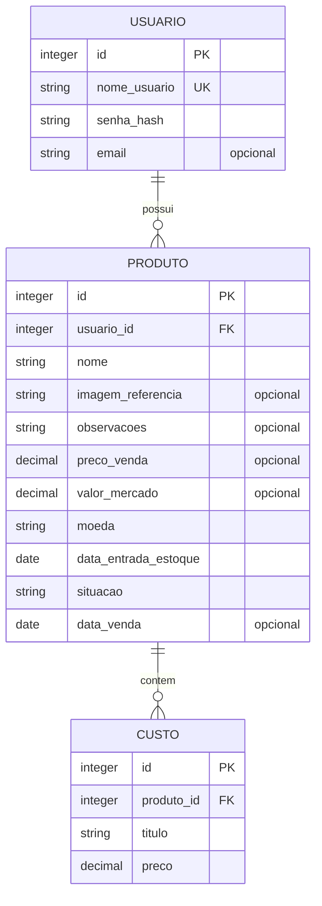

# Especificação: Plataforma de Gestão de Custos de Produtos

## 1. Objetivo e escopo

Especificar a aplicação web e Android descrita em [PRD.md](./PRD.md), respeitando as decisões adicionais confirmadas para esta especificação. A aplicação ajuda pessoas e pequenos negócios a cadastrar produtos e custos, acompanhar estoque e vendas e consultar resultados financeiros.

### Plataformas e stack

- **Web:** React, responsivo para desktop e dispositivos móveis.
- **Android:** React Native, com as mesmas funções centrais da versão web.
- **Backend:** Go, responsável pela API, autenticação, autorização, sincronização e acesso aos dados compartilhados.
- **Persistência:** SQLite. O Android deve manter localmente os dados sincronizados e as alterações pendentes para oferecer o uso offline definido nesta especificação; o backend deve persistir os dados compartilhados.
- A web e o Android consultam os dados da mesma conta por meio do backend. A web requer conexão para sincronizar e consultar dados atualizados.

## 2. Requisitos funcionais

### RF-01 — Contas e acesso

- Permitir cadastro aberto com nome de usuário obrigatório, senha obrigatória e e-mail opcional.
- Permitir autenticação por nome de usuário e senha.
- Associar cada produto à conta proprietária.
- Autorizar operações de leitura e escrita somente sobre dados da conta autenticada.
- O fluxo de recuperação de senha não faz parte desta especificação.

### RF-02 — Cadastro e manutenção de produtos

Cada produto deve permitir:

- Nome obrigatório.
- Imagem opcional, que pode ser adicionada, substituída ou removida. Formatos aceitos: JPEG, PNG e WebP; tamanho máximo: 5 MB por imagem. A interface deve informar essas restrições.
- Observações opcionais, também visíveis na lista principal.
- Preço de venda opcional.
- Valor de referência de mercado opcional.
- Moeda do produto, selecionável entre as moedas oferecidas pela fonte gratuita de câmbio escolhida para a implementação; BRL é o padrão.
- Data de entrada no estoque obrigatória, preenchida com a data atual ao criar o produto e editável.
- Situação: em estoque ou vendido.
- Data da venda obrigatória enquanto o produto estiver vendido.
- Lista de custos associada.

Permitir criar, consultar, editar e excluir produtos. A exclusão deve seguir as três etapas abaixo:

1. Iniciar a exclusão.
2. Confirmar em uma caixa de diálogo.
3. Confirmar novamente informando o nome do produto.

A confirmação final deve informar que a exclusão é irreversível. A regra também se aplica a produtos vendidos.

### RF-03 — Custos

- Cada custo deve ter título e preço obrigatórios.
- Permitir adicionar, editar e remover qualquer quantidade de custos de um produto.
- Rejeitar valores monetários negativos.
- Calcular o custo total do produto pela soma dos custos cadastrados; sem custos, o total é zero.
- Atualizar o total imediatamente após inclusão, edição ou remoção de custo.

### RF-04 — Estoque e vendas

- Permitir marcar um produto como vendido por um controle simples, como checkbox ou equivalente.
- Ao marcar como vendido, solicitar a data da venda, inicialmente preenchida com a data atual; permitir editar essa data.
- Ao retornar um produto vendido para estoque, remover a data da venda. Na venda seguinte, solicitá-la novamente.
- Produtos vendidos deixam a visão de estoque atual e passam à visão de vendidos.
- Mostrar situação e datas de forma consistente na web e no Android.

### RF-05 — Lista principal e detalhes

- Oferecer acesso à lista completa de produtos e permitir filtrá-la por situação: em estoque ou vendido.
- Mostrar por produto: imagem, nome, situação, observações quando preenchidas, custo total e preço de venda lado a lado, valor de mercado quando informado, data de entrada e, para vendidos, data da venda.
- Na visualização de detalhes, apresentar todos os campos do produto e os custos individuais.
- Disponibilizar um controle claro para ocultar ou revelar valores de custo nas telas operacionais. Ocultar custos não altera dados nem cálculos e não oculta o preço de venda. A indicação do estado atual deve permanecer visível.
- Na lista principal, permitir alternar entre a moeda original de cada produto e BRL. A moeda original é a moeda escolhida no produto.

### RF-06 — Análises

Disponibilizar três visões por abas ou controles equivalentes:

1. **Estoque atual:** produtos ainda não vendidos.
2. **Vendidos:** produtos vendidos, com filtros por mês, ano e período analisado.
3. **Todo o período:** histórico consolidado, sem excluir registros por causa dos filtros de mês e ano.

Cada visão deve:

- Exibir indicadores em texto e um gráfico de pizza para comparar custos e receita, com o lucro indicado no gráfico quando positivo.
- Apresentar também em texto acessível todos os valores representados, sem depender somente de cores ou do gráfico.
- Informar a quantidade de produtos considerada em cada indicador financeiro.
- Usar valores em BRL, convertidos da moeda do produto pela taxa mais recente disponível, inclusive para registros históricos. Usar somente uma fonte externa de câmbio gratuita. Se uma taxa necessária não estiver disponível, mostrar “Não disponível” ou equivalente, sem tratar a taxa ou o valor ausente como zero.
- No Android offline, usar a última taxa disponível já armazenada localmente; se não houver uma taxa armazenada para a conversão, mostrar “Não disponível”.

Na visão **Estoque atual**:

- Exibir sempre o custo total de todos os produtos em estoque, inclusive os que não têm preço de venda.
- Calcular receita e lucro estimados apenas para produtos em estoque com preço de venda informado. O custo usado no lucro estimado deve corresponder somente a esses produtos.

Na visão **Vendidos**:

- Aplicar filtros de mês, ano e período à data de venda.
- Apresentar despesas, receita e lucro realizados para o recorte selecionado.

Na visão **Todo o período**:

- Consolidar todos os registros históricos disponíveis, sem aplicar os filtros da visão de vendidos.

Se o resultado for prejuízo, mostrar custos e prejuízo em texto e indicar essa condição; não representar lucro negativo como uma fatia positiva do gráfico.

### RF-07 — Comparação com o mercado

- Para cada produto com preço de venda e valor de mercado informados, mostrar a diferença em valor e percentual, deixando explícito se o preço está acima ou abaixo da referência.
- Nos totais, incluir somente produtos com preço de venda e referência de mercado informados.
- Comparar a soma dos preços de venda com a soma dos valores de mercado desses produtos e informar explicitamente a quantidade considerada.
- Se não houver dados suficientes, mostrar “Não disponível” ou equivalente; não converter referências ausentes em zero.

### RF-08 — Sincronização e operação offline no Android

- Os dados sincronizados de uma conta devem estar disponíveis na web e no Android após sincronização.
- O Android deve permitir, usando dados previamente sincronizados e sem conexão: consultar dados, cadastrar, editar e excluir produtos e custos, registrar vendas e consultar análises.
- Registrar localmente as alterações feitas offline como pendentes de sincronização.
- Ao tentar sincronizar alterações conflitantes do mesmo produto, apresentar as versões conflitantes e solicitar ao usuário que escolha qual manter. Não descartar silenciosamente nenhuma versão.
- Comunicar claramente os estados de carregamento, sucesso, falha, offline e alterações pendentes.
- Persistir os dados após fechar e reabrir o aplicativo.

## 3. Regras de negócio e cálculos

### Valores por produto e moeda

- **Custo total do produto:** soma dos preços de todos os custos associados.
- Valores monetários inseridos para um produto usam a moeda selecionada nesse produto; BRL é o valor inicial.
- A lista principal pode mostrar o valor na moeda original do produto ou em BRL. As análises usam BRL.
- Conversões usam a taxa mais recente disponível para todas as visualizações, inclusive períodos históricos. Taxas indisponíveis não são zero.

### Indicadores financeiros

- **Despesas/custos do conjunto:** soma dos custos totais dos produtos considerados no recorte.
- **Receita realizada:** soma dos preços de venda dos produtos vendidos no recorte.
- **Lucro realizado:** receita realizada menos os custos totais dos produtos vendidos no recorte.
- **Receita estimada do estoque:** soma dos preços de venda informados para produtos ainda em estoque.
- **Lucro estimado do estoque:** receita estimada menos os custos dos produtos em estoque com preço de venda informado.
- Produtos sem preço de venda não entram nos indicadores financeiros de receita e lucro nem na contagem de produtos desses indicadores. A exceção é o custo total do estoque atual, que inclui todos os produtos em estoque.
- Para o gráfico, custos e lucro positivo compõem a receita dos produtos considerados. Mostrar o valor total da receita junto ao gráfico e os valores em texto. Em caso de prejuízo, não desenhar uma fatia positiva de lucro.
- Quando não houver dados suficientes para um indicador, apresentar “Não disponível” ou equivalente.

### Mercado

- **Diferença por produto:** preço de venda menos valor de mercado.
- **Percentual por produto:** diferença dividida pelo valor de mercado, multiplicada por 100.
- **Diferença agregada:** soma dos preços de venda menos soma dos valores de mercado dos produtos incluídos.
- **Percentual agregado:** diferença agregada dividida pela soma dos valores de mercado incluídos, multiplicada por 100.
- A comparação agregada inclui apenas produtos que tenham ambos os valores, preço de venda e referência de mercado. Informar a quantidade incluída.

## 4. Requisitos não funcionais

### RNF-01 — Usabilidade e acessibilidade

- A web deve ser responsiva para desktop e dispositivos móveis; o Android deve ser adequado a telas móveis.
- Navegação e controles principais devem funcionar por teclado na web e com leitores de tela na web e no Android.
- Controles de situação, ocultação de custos, moeda e sincronização devem comunicar seu estado atual de forma clara.
- Gráficos devem ter os valores também disponíveis em texto acessível.
- Exibir mensagens claras para campos inválidos, estados de carregamento, sucesso, falha, ausência de dados, modo offline e conflitos de sincronização.

### RNF-02 — Persistência e consistência

- Persistir os dados depois que o aplicativo for fechado e reaberto.
- Usar datas consistentes no armazenamento e apresentá-las no formato local do usuário.
- Manter situação, datas, custos e valores coerentes entre plataformas depois da sincronização.
- Preservar alterações offline pendentes até que sejam sincronizadas ou resolvidas pelo usuário.

### RNF-03 — Segurança e privacidade

- Proteger os dados de custos e vendas contra acesso por usuários não autorizados.
- Validar autorização no backend para cada operação e garantir isolamento entre contas.
- Transmitir credenciais e dados da aplicação por HTTPS.
- Não armazenar senhas em texto puro; armazenar hashes de senha com sal usando algoritmo apropriado para senhas.
- Validar no backend os campos obrigatórios, os valores monetários não negativos e os arquivos de imagem (formato e limite de tamanho), sem confiar apenas na validação da interface.
- Não revelar dados de uma conta em respostas de erro, registros ou resultados de busca de outra conta.
- A opção de ocultar custos é uma proteção visual operacional, não uma substituição da autorização de acesso aos dados.
- Usar somente serviços externos gratuitos para obter taxas de câmbio. A escolha do serviço fica para a implementação, sem exigir serviço pago.

## 5. Casos de uso

### UC-01 — Criar conta e entrar

**Ator:** usuário não autenticado.

**Fluxo principal:** informa nome de usuário e senha, podendo informar e-mail; cria a conta e autentica-se. O sistema associa os dados criados à conta autenticada.

**Alternativa:** credenciais inválidas resultam em mensagem clara, sem expor dados da conta.

### UC-02 — Cadastrar produto e custos

**Ator:** usuário autenticado.

**Fluxo principal:** informa nome, moeda e demais campos opcionais; a data de entrada é inicialmente preenchida com a data atual. Adiciona um ou mais custos com título e preço. O sistema valida os campos, calcula o custo total e disponibiliza o produto na lista.

**Alternativas:** valores obrigatórios ausentes, valores negativos ou imagem inválida são rejeitados com indicação do campo a corrigir.

### UC-03 — Consultar e editar produto

**Ator:** usuário autenticado.

**Fluxo principal:** localiza o produto na lista, consulta seus dados e custos, e altera campos ou custos. O sistema atualiza o custo total após cada alteração e reflete a mudança nas análises correspondentes.

### UC-04 — Ocultar ou revelar custos

**Ator:** usuário autenticado.

**Fluxo principal:** aciona o controle de ocultação na interface operacional. Os valores de custo deixam de ser exibidos, enquanto o preço de venda permanece visível; ao revelar, os valores voltam a aparecer. Os dados e cálculos permanecem inalterados.

### UC-05 — Registrar venda ou retorno ao estoque

**Ator:** usuário autenticado.

**Fluxo principal:** marca um produto como vendido; o sistema solicita a data, inicialmente igual à data atual, e move o produto para vendidos. O usuário pode editar a data.

**Alternativa:** ao voltar o produto ao estoque, o sistema remove a data de venda; uma venda posterior solicita uma nova data.

### UC-06 — Consultar análises

**Ator:** usuário autenticado.

**Fluxo principal:** seleciona Estoque atual, Vendidos ou Todo o período. Na visão de vendidos, aplica filtros de mês, ano e período. O sistema calcula e apresenta indicadores, comparação com mercado quando possível, gráfico e valores em texto acessível.

**Alternativas:** dados ou taxas insuficientes são indicados como indisponíveis, sem apresentar valores ausentes como zero.

### UC-07 — Excluir produto

**Ator:** usuário autenticado.

**Fluxo principal:** inicia a exclusão, confirma na caixa de diálogo e informa o nome do produto na confirmação final. O sistema apresenta o aviso de irreversibilidade e, após a confirmação, remove o produto e seus custos associados.

### UC-08 — Usar o Android offline e sincronizar

**Ator:** usuário autenticado no Android.

**Fluxo principal:** consulta dados sincronizados e cria ou altera produtos, custos e vendas sem conexão. O sistema persiste localmente as alterações e informa que estão pendentes. Após recuperar conectividade, inicia a sincronização e comunica o resultado.

**Alternativa de conflito:** se a mesma informação tiver sido alterada em outra plataforma, o sistema apresenta as versões conflitantes e aguarda a escolha do usuário antes de concluir a sincronização.

## 6. Modelo de dados (DER)

**Restrições do modelo:**

- `PRODUTO.usuario_id` identifica a conta proprietária; toda leitura e escrita deve respeitar essa propriedade.
- `CUSTO.produto_id` associa cada custo a exatamente um produto.
- `situacao` aceita somente os estados em estoque e vendido. A data de venda é obrigatória para vendido e ausente para em estoque.
- Preço de venda e valor de mercado são opcionais; quando informados, e todo preço de custo, devem ser não negativos.
- A moeda é registrada no produto e define a moeda dos valores monetários desse produto.
- A implementação pode manter localmente pendências de sincronização e taxas de câmbio em cache; esses dados operacionais não alteram as relações de propriedade acima.

## 7. Testes das funções do software

Os testes devem cobrir as funções de domínio, os fluxos de integração e as regras de autorização. Valores monetários de teste devem ser comparados com precisão decimal adequada à implementação monetária, evitando erros de ponto flutuante.

### Testes unitários de domínio

| ID | Função/regra | Cenário | Resultado esperado |
|---|---|---|---|
| T-01 | Calcular custo total | Produto sem custos | Total igual a zero |
| T-02 | Calcular custo total | Custos adicionados, editados ou removidos | Total igual à soma atual dos custos |
| T-03 | Validar custo | Título ou preço ausente | Validação rejeita o custo |
| T-04 | Validar valor monetário | Preço de custo, venda ou mercado negativo | Validação rejeita o valor |
| T-05 | Alterar situação | Marcar como vendido sem data informada | Solicitar data, preenchida inicialmente com a data atual |
| T-06 | Alterar situação | Retornar vendido para estoque | Remover data da venda |
| T-07 | Calcular estoque | Produtos com e sem preço de venda | Custo total inclui todos; receita e lucro usam somente os que têm preço |
| T-08 | Calcular vendido | Produtos vendidos no recorte, com e sem preço | Receita, lucro e contagem excluem os sem preço de venda |
| T-09 | Calcular período | Mês, ano e período selecionados | Incluir somente vendas cuja data esteja no recorte |
| T-10 | Calcular todo o período | Existem filtros ativos na visão de vendidos | Consolidar histórico sem aplicar esses filtros |
| T-11 | Calcular lucro | Receita maior que custos | Lucro positivo igual à receita menos custos |
| T-12 | Calcular prejuízo | Custos maiores que receita | Mostrar prejuízo em texto e não criar fatia positiva para lucro |
| T-13 | Comparar mercado por produto | Preço de venda e mercado informados | Diferença e percentual corretos, com indicação acima/abaixo |
| T-14 | Comparar mercado agregado | Produtos com referência e preço de venda, mais produtos sem um desses valores | Somar e contar somente os produtos com ambos os valores |
| T-15 | Comparar mercado | Nenhum produto comparável ou soma de referência indisponível/zero | Indicar indisponibilidade, sem divisão inválida ou valores ausentes tratados como zero |
| T-16 | Converter moeda | Taxa mais recente disponível | Converter o valor original para BRL usando essa taxa, inclusive para registros históricos |
| T-17 | Converter moeda offline | Taxa local disponível ou ausente | Usar a taxa armazenada; sem taxa, indicar indisponibilidade |
| T-18 | Validar imagem | JPEG, PNG ou WebP de até 5 MB | Aceitar o arquivo |
| T-19 | Validar imagem | Formato não permitido ou arquivo acima de 5 MB | Rejeitar e informar os limites |

### Testes de integração e segurança

| ID | Fluxo | Cenário | Resultado esperado |
|---|---|---|---|
| T-20 | Conta | Criar conta com nome de usuário e senha, com e sem e-mail | Cadastro aceito quando os campos obrigatórios forem válidos |
| T-21 | Autorização | Conta A solicita produto pertencente à conta B | Operação negada sem revelar os dados de B |
| T-22 | Credenciais | Criar conta e inspecionar os dados persistidos | Senha não é armazenada em texto puro |
| T-23 | Persistência | Cadastrar produto e custos, fechar e reabrir o aplicativo | Dados permanecem disponíveis |
| T-24 | Ocultação de custos | Ocultar valores nas telas operacionais | Custos ocultos, preço de venda visível e cálculos inalterados |
| T-25 | Exclusão | Confirmar cada uma das três etapas | Exclusão somente após a terceira confirmação; produto e custos deixam de existir |
| T-26 | Sincronização | Alterar produto offline no Android e reconectar sem conflito | Alterações pendentes são sincronizadas e aparecem na web |
| T-27 | Conflito | Produto alterado na web e no Android offline | Apresentar ambas as versões, aguardar escolha e não descartar alteração silenciosamente |
| T-28 | Sincronização | Falha de conexão ou da sincronização | Informar falha, preservar alterações pendentes e permitir nova tentativa |
| T-29 | Análises acessíveis | Exibir gráfico com dados | Valores e condição de lucro/prejuízo também estão disponíveis em texto acessível |
| T-30 | Validação no backend | Enviar valor negativo ou imagem inválida diretamente à API | Rejeitar a entrada mesmo que a validação da interface seja contornada |

## 8. Fora do escopo

Não implementar nesta versão:

- Quantidades múltiplas por produto ou variações de tamanho/cor.
- Integração com meios de pagamento, emissão fiscal, fornecedores ou marketplaces.
- Importação em lote, leitura automática de notas ou reconhecimento de imagem.
- Múltiplos usuários por equipe, permissões por equipe ou múltiplos estoques.
- Recuperação de senha.
- Uso de serviço pago para conversão cambial.
